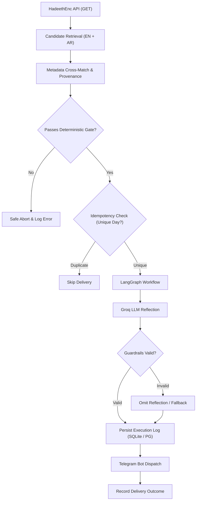

# Daily Hadith AI Agent

A production-oriented, fail-closed AI system that delivers verified daily Hadith notifications to Telegram, orchestrated with **LangGraph**, verified deterministically with **Pydantic**, and powered by **FastAPI** and **Groq**.

---

## Problem Statement

Generative AI models are probabilistic by nature—they hallucinate, paraphrase without permission, and confabulate citations. When building software around sacred or canonical domain texts (such as Hadith literature, legal statutes, or clinical guidelines), probabilistic generation without deterministic boundaries is unacceptable.

A naive implementation might ask an LLM to *"send a daily Hadith from Sahih al-Bukhari"*. This frequently results in invented chains of narration (Isnad), paraphrased translations, or fabricated references.

**Daily Hadith AI Agent** solves this through architectural rigor:
- **Canonical texts are never generated or modified by AI.** The English translation is retrieved directly from an approved primary source ([HadeethEnc](https://hadeethenc.com/en/home)) via its official API and preserved with byte-for-byte fidelity.
- **Deterministic verification gates** run before any LLM is invoked. If references, metadata, or English/Arabic cross-matching fail, the pipeline terminates immediately (*fail-closed*).
- **Generative AI is strictly isolated** to supplementary educational reflections, clearly demarcated as non-canonical commentary.

---

## System Architecture



---

## Key Features & Reliability Principles

1. **Deterministic Content Gates:** Every candidate record undergoes Pydantic schema validation, reference consistency checks, and English/Arabic pair matching.
2. **Fail-Closed Safety:** If external APIs are unresponsive, references are ambiguous, or metadata is incomplete, the system rejects the candidate rather than dispatching unverified religious material.
3. **Exact Source Attribution:** Every notification includes the authentic collection title, verified reference number, canonical HadeethEnc URL, and translation-version metadata.
4. **Idempotent Delivery:** State is persisted to guard against duplicate notifications caused by scheduler misfires, process restarts, or network retries.
5. **Clear AI Separation:** Any LLM-generated reflection is explicitly labeled: `AI-generated reflection — not part of the original Hadith`.
6. **No Web Scraping:** Only official API endpoints and documented access methods are utilized.

---

## Technology Stack

| Layer | Technology | Purpose |
|---|---|---|
| **Language** | Python 3.14 / 3.13 | Primary development runtime |
| **Workflow Engine** | LangGraph | State graph orchestration with conditional failure routing |
| **LLM Provider** | Groq (`openai/gpt-oss-120b`) | Low-latency inference for educational reflections |
| **Validation** | Pydantic v2 + Guardrails AI | Deterministic structural validation and reflection boundaries |
| **Web Framework** | FastAPI | Modular API routes, health checks, and trigger endpoints |
| **Persistence** | SQLite / Neon PostgreSQL | Local development storage transitioning to managed cloud DB |
| **Notifications** | Telegram Bot API | Single confirmed notification channel for V1 |
| **DevOps & QA** | Docker, pytest, Ruff | Containerization, automated testing, and strict linting |

---

## Source Scope & Attribution Notice

- **Primary Source:** Curated records from [HadeethEnc](https://hadeethenc.com/en/home).
- **Target Collections:** Sahih al-Bukhari and Sahih Muslim.
- **Coverage Disclaimer:** HadeethEnc is an encyclopedic, curated selection of Hadith. This application does not claim to index the exhaustive contents of both collections.
- **Translation Integrity:** English translations are preserved exactly as published by HadeethEnc under their documented reuse guidelines.

---

## Project Structure

```
Hadith-ai-agent/
├── docs/                   # Durable technical documentation & specifications
│   ├── PROJECT_ROADMAP.md  # 20-milestone roadmap with verified acceptance criteria
│   ├── PROJECT_CONTEXT.md  # State-of-the-project developer handover document
│   └── ARCHITECTURE.md     # In-depth architectural designs (Milestone 2+)
├── src/                    # Application source code
│   └── .gitkeep
├── tests/                  # Automated pytest test suite
│   └── .gitkeep
├── .gitignore              # Environment, credential, and cache exclusions
└── README.md               # Repository overview
```

---

## Project Status

This project is actively developed following a 20-milestone engineering roadmap.

- **Current Milestone:** `Milestone 01 — Project Foundation and Documentation` (`In Progress`)
- **Implemented to Date:**
  - Workspace and runtime environment audit.
  - Git repository structure with comprehensive `.gitignore`.
  - Directory scaffolding (`docs/`, `src/`, `tests/`).
  - 20-milestone tracked roadmap (`docs/PROJECT_ROADMAP.md`).
  - Developer handover and context tracker (`docs/PROJECT_CONTEXT.md`).
  - Public repository documentation (`README.md`).

For detailed milestone breakdowns, see [docs/PROJECT_ROADMAP.md](docs/PROJECT_ROADMAP.md).

---

## Local Development Setup

*(Detailed dependency setup instructions will be introduced in Milestone 03 after configuration models are defined.)*

### Prerequisites
- Python 3.13 or 3.14
- Git

### Cloning the Repository
```bash
git clone https://github.com/<your-username>/daily-hadith-ai-agent.git
cd daily-hadith-ai-agent
```

---

## Security & Secrets Policy

- **Zero Hardcoded Secrets:** Credentials (Telegram bot tokens, Groq API keys, database connection strings) are strictly managed via environment variables.
- **`.env` is Git-Ignored:** Real configuration files are never committed to version control. An audited `.env.example` will be provided with dummy placeholders.

---

## License

Application source code license will be established following evaluation of third-party source reuse terms. Content retrieved from HadeethEnc remains subject to the publisher's terms of service and attribution requirements.

```
Hadith-ai-agent/
├── docs/                   # Durable technical documentation & specifications
│   ├── PROJECT_ROADMAP.md  # 20-milestone roadmap with verified acceptance criteria
│   ├── PROJECT_CONTEXT.md  # State-of-the-project developer handover document
│   └── ARCHITECTURE.md     # In-depth architectural designs (Milestone 2+)
├── src/                    # Application source code
│   └── .gitkeep
├── tests/                  # Automated pytest test suite
│   └── .gitkeep
├── .gitignore              # Environment, credential, and cache exclusions
└── README.md               # Repository overview
```

---

## Project Status

This project is actively developed following a 20-milestone engineering roadmap.

- **Current Milestone:** `Milestone 01 — Project Foundation and Documentation` (`In Progress`)
- **Implemented to Date:**
  - Workspace and runtime environment audit.
  - Git repository structure with comprehensive `.gitignore`.
  - Directory scaffolding (`docs/`, `src/`, `tests/`).
  - 20-milestone tracked roadmap (`docs/PROJECT_ROADMAP.md`).
  - Developer handover and context tracker (`docs/PROJECT_CONTEXT.md`).
  - Public repository documentation (`README.md`).

For detailed milestone breakdowns, see [docs/PROJECT_ROADMAP.md](docs/PROJECT_ROADMAP.md).

---

## Local Development Setup

*(Detailed dependency setup instructions will be introduced in Milestone 03 after configuration models are defined.)*

### Prerequisites
- Python 3.13 or 3.14
- Git

### Cloning the Repository
```bash
git clone https://github.com/<your-username>/daily-hadith-ai-agent.git
cd daily-hadith-ai-agent
```

---

## Security & Secrets Policy

- **Zero Hardcoded Secrets:** Credentials (Telegram bot tokens, Groq API keys, database connection strings) are strictly managed via environment variables.
- **`.env` is Git-Ignored:** Real configuration files are never committed to version control. An audited `.env.example` will be provided with dummy placeholders.

---

## License

Application source code license will be established following evaluation of third-party source reuse terms. Content retrieved from HadeethEnc remains subject to the publisher's terms of service and attribution requirements.
