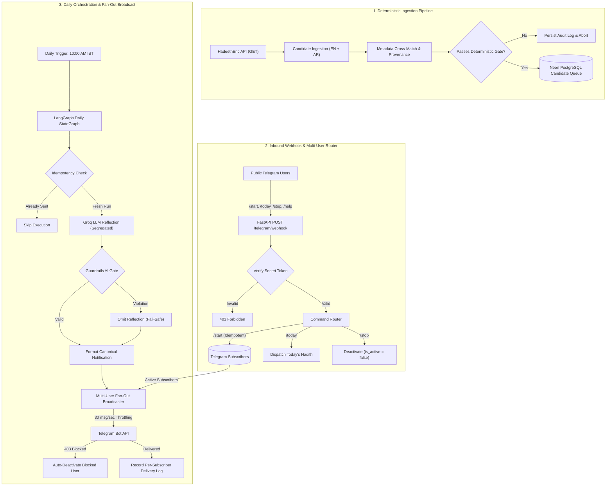

# Daily Hadith AI Agent

A production-grade, fail-closed AI system and publicly accessible Telegram bot delivering verified daily Hadith notifications to subscribers, orchestrated with **LangGraph**, verified deterministically with **Pydantic**, persisted on **Neon PostgreSQL**, and powered by **Groq**.

[](https://www.python.org/downloads/)
[](https://github.com/langchain-ai/langgraph)
[](https://neon.tech/)
[](LICENSE)
[-brightgreen.svg)](tests/)
[](tests/)
[](https://github.com/astral-sh/ruff)

---

## Core Problem & Engineering Philosophy

Generative AI models are probabilistic by nature—they hallucinate, paraphrase without permission, and confabulate citations. When building software around sacred or canonical domain texts (such as Hadith literature, legal statutes, or clinical guidelines), probabilistic generation without deterministic boundaries is unacceptable.

A naive implementation might ask an LLM to *"send a daily Hadith from Sahih al-Bukhari"*. This frequently results in invented chains of narration (Isnad), paraphrased translations, or fabricated references.

**Daily Hadith AI Agent** solves this through architectural rigor:
- **Canonical texts are never generated or modified by AI.** The English translation is retrieved directly from an approved primary source ([HadeethEnc](https://hadeethenc.com/en/home)) via its official API and preserved with byte-for-byte fidelity.
- **Deterministic verification gates** run before any LLM is invoked. If references, metadata, or English/Arabic cross-matching fail, the pipeline terminates immediately (*fail-closed*).
- **Generative AI is strictly isolated** to supplementary educational reflections, clearly demarcated as non-canonical commentary.

---

## System Architecture



---

## Repository Structure & Package Guides

Every folder in this codebase includes its own dedicated README guide:

| Directory | Package / Component | Documentation Guide |
|---|---|---|
| **[`docs/`](docs/)** | Technical Specifications & Handover Records | **[`docs/README.md`](docs/README.md)** |
| **[`src/`](src/)** | Application Source Root & Architecture Overview | **[`src/README.md`](src/README.md)** |
| **[`src/database/`](src/database/)** | Neon PostgreSQL Persistence, Models & Migrations | **[`src/database/README.md`](src/database/README.md)** |
| **[`src/hadeethenc/`](src/hadeethenc/)** | HadeethEnc API Client, Schemas & Invariant Verifier | **[`src/hadeethenc/README.md`](src/hadeethenc/README.md)** |
| **[`src/ingestion/`](src/ingestion/)** | Candidate Ingestion Service & Deduplication | **[`src/ingestion/README.md`](src/ingestion/README.md)** |
| **[`src/workflow/`](src/workflow/)** | LangGraph StateGraph Orchestration & Routing | **[`src/workflow/README.md`](src/workflow/README.md)** |
| **[`src/llm/`](src/llm/)** | Groq LLM Reflections, Prompts & Graceful Fallback | **[`src/llm/README.md`](src/llm/README.md)** |
| **[`src/guardrails/`](src/guardrails/)** | Deterministic Hallucination & Theological Guardrails | **[`src/guardrails/README.md`](src/guardrails/README.md)** |
| **[`src/formatter/`](src/formatter/)** | Telegram Notification Formatter & HTML Payload Assembly | **[`src/formatter/README.md`](src/formatter/README.md)** |
| **[`src/delivery/`](src/delivery/)** | Telegram Bot API Client, Webhook Router & Multi-User Broadcaster | **[`src/delivery/README.md`](src/delivery/README.md)** |
| **[`tests/`](tests/)** | Automated Test Suite (94 unit & integration tests across 12 modules) | **[`tests/README.md`](tests/README.md)** |
| **[`scripts/`](scripts/)** | Standalone Operational & Live E2E Verification Scripts | **[`scripts/README.md`](scripts/README.md)** |
| **[`alembic/`](alembic/)** | Database Schema Migration Versions | **[`alembic/README.md`](alembic/README.md)** |

---

## Key Reliability Principles

1. **Deterministic Content Gates:** Every candidate record undergoes Pydantic schema validation, reference consistency checks, and English/Arabic pair matching.
2. **Fail-Closed Safety:** If external APIs are unresponsive, references are ambiguous, or metadata is incomplete, the system rejects the candidate rather than dispatching unverified religious material.
3. **Exact Source Attribution:** Every notification includes the authentic collection title, verified reference number, canonical HadeethEnc URL, and translation-version metadata.
4. **Physical Idempotency:** Neon PostgreSQL enforces a `UNIQUE` constraint on `DailyDeliveryLog.scheduled_date`, ensuring at most one delivery per calendar day.
5. **Clear AI Separation:** Any LLM-generated reflection is explicitly labeled: `AI-generated reflection — not part of the original Hadith`.
6. **No Web Scraping:** Only official REST API endpoints are utilized.

---

## Project Status & Roadmap

The project is actively developed following a 20-milestone engineering roadmap:

| Milestone | Status | Key Deliverable |
|---|---|---|
| **01 — Project Foundation** | `Verified` | Git repo, environment audit, documentation scaffolding |
| **02 — Source Validation Spec** | `Verified` | HadeethEnc API contracts & Arabic reference regex grammar |
| **03 — Configuration & Secrets** | `Verified` | Pydantic Settings, secret masking, timezone validation |
| **04 — Database Foundation** | `Verified` | Neon PostgreSQL connection, SQLAlchemy models, Alembic migrations |
| **05 — HadeethEnc Integration** | `Verified` | Typed HTTP client, Pydantic schemas, invariant verifier |
| **06 — Source Catalogue Audit** | `Verified` | Empirical audit of 2,776+ Hadiths, acceptance policy |
| **07 — Deterministic Engine** | `Verified` | Ingestion service, queue persistence, live cloud verification |
| **08 — LangGraph Workflow** | `Verified` | StateGraph state machine with conditional routing & live idempotency |
| **09 — Groq Integration** | `Verified` | LLM reflection generation with strict segregation |
| **10 — Guardrails AI** | `Verified` | Content validation & hallucination boundary enforcement |
| **11 — Final Content Validation** | `Verified` | Assembled notification payloads & HTML escaping checks |
| **12 — Telegram Integration & Public Subscription Engine** | `Verified` | Public bot webhook, subscriber registration, commands & rate-limited broadcast |
| **13 — Scheduling & Daily Multi-User Broadcast** | `Verified` | Headless runner CLI, APScheduler (10 AM IST, 1hr misfire grace), Cloud Scheduler cron endpoint |
| **14 — History & Per-Subscriber Daily Idempotency** | `Verified` | Composite idempotency unique constraints, mid-run recovery queries & per-user delivery logs |
| **15 — Failure Handling** | `Verified` | Fault tolerance, retry exponential backoff & fail-closed resilience stress tests (19 tests) |
| **16 — Automated Testing** | `Verified` | Automated test suite (94 tests, 89% coverage), Ruff linting & code formatting audits |
| **17 — Docker Containerization** | `In Progress` | Multi-stage Docker containerization, non-root execution & container health check |

For the complete 20-milestone breakdown, see **[`docs/PROJECT_ROADMAP.md`](docs/PROJECT_ROADMAP.md)**.

---

## Local Development Setup

### Prerequisites
- Python 3.14 or 3.13
- Git

### Installation
```bash
# Clone the repository
git clone https://github.com/Amankhan1009/daily-hadith-ai-agent.git
cd daily-hadith-ai-agent

# Create and activate virtual environment
python3 -m venv .venv
source .venv/bin/activate

# Install dependencies
pip install -r requirements.txt
```

### Running the Test Suite
```bash
.venv/bin/pytest -v
```

---

## License & Attribution

- **Source Code:** MIT License.
- **Hadith Content:** Retrieved from [HadeethEnc](https://hadeethenc.com/en/home) and attributed under their open non-commercial educational reuse guidelines.
