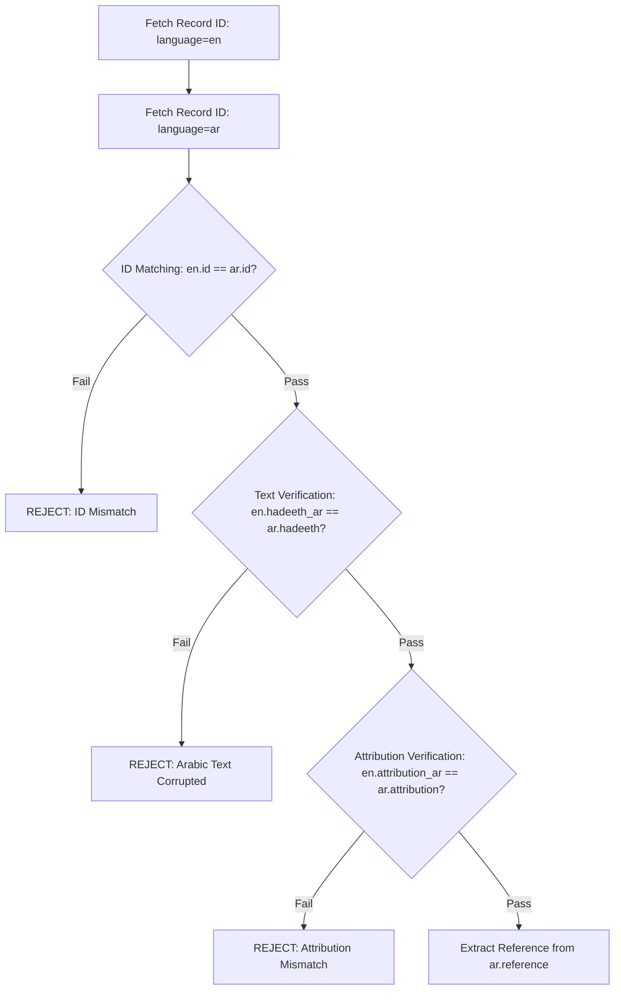

# API Contracts & Data Ingestion Specification

> **Durable Technical Specification**  
> *Component:* Source Ingestion, Reference Verification, and External APIs  
> *Milestone:* Milestone 02 — Source Validation Specification

---

## 1. Overview & Design Philosophy

The **Daily Hadith AI Agent** treats all retrieved external data as unverified input until it passes deterministic verification gates. 

Because we are dealing with canonical religious literature, **probabilistic AI validation is prohibited for source text, attribution, and citations**. This document defines the exact contracts for:
1. The **HadeethEnc REST API** (primary source candidate).
2. The **Deterministic English-Arabic Cross-Matching Algorithm**.
3. The **Collection and Reference Verification Grammar** (Sahih al-Bukhari & Sahih Muslim).
4. The **Fail-Closed Rejection Matrix**.
5. The **Telegram Bot API Dispatch Contract**.

---

## 2. HadeethEnc API Contract

Official Base URL: `https://hadeethenc.com/api/v1/`  
Authentication: **None** (public GET endpoints; verified empirically).  
Scraping Policy: **Strictly Prohibited**. All data is fetched via documented REST endpoints.

### 2.1 Available Endpoints

| Endpoint | Method | Key Query Parameters | Description |
|---|---|---|---|
| `/categories/list/` | `GET` | `language` (`en`, `ar`) | Lists all subject categories and Hadith counts |
| `/hadeeths/list/` | `GET` | `language`, `category_id`, `page`, `per_page` | Returns paginated list of Hadith summaries |
| `/hadeeths/one/` | `GET` | `language`, `id` | Returns complete details for a single Hadith record |

---

### 2.2 Endpoint: `GET /hadeeths/one/?language=en&id={id}`

#### Observed Response Schema (English)
```json
{
  "id": "5913",
  "title": "The best of you are those who learn the Qur’an and teach it",
  "hadeeth": "Abu ‘Abd ar-Rahmān as-Sulami reported from ‘Uthmān ibn ‘Affān...",
  "attribution": "Narrated by Al-Bukhāri",
  "grade": "Authentic",
  "explanation": "The Prophet (may Allah's peace and blessings be upon him) said...",
  "hints": [
    "Teaching the Qur'an and learning it are among the best deeds..."
  ],
  "categories": ["39"],
  "translations": ["ar", "bn", "bs", "en", "es", "fr", "ur", "..."],
  "hadeeth_intro": "‘Uthmān ibn ‘Affān (may Allah be pleased with him) reported...",
  "hadeeth_ar": "عن عثمان بن عفان رضي الله عنه عن النبي صلى الله عليه وسلم قال: «خيركم من تعلم القرآن وعلمه».",
  "hadeeth_intro_ar": "عن عثمان بن عفان رضي الله عنه عن النبي صلى الله عليه وسلم قال:",
  "explanation_ar": "قال النبي صلى الله عليه وسلم...",
  "hints_ar": ["..."],
  "words_meanings_ar": [],
  "attribution_ar": "رواه البخاري",
  "grade_ar": "صحيح"
}
```

> [!IMPORTANT]
> **Critical Discovery:** The English response payload does **not** include the specific book and Hadith reference number (the `reference` key is omitted entirely from the English JSON object). However, the English response **does include** `hadeeth_ar` (the full Arabic text) and `attribution_ar` (`رواه البخاري`).

---

### 2.3 Endpoint: `GET /hadeeths/one/?language=ar&id={id}`

#### Observed Response Schema (Arabic)
```json
{
  "id": "5913",
  "title": "خيركم من تعلم القرآن وعلمه",
  "hadeeth": "عن عثمان بن عفان رضي الله عنه عن النبي صلى الله عليه وسلم قال: «خيركم من تعلم القرآن وعلمه».",
  "attribution": "رواه البخاري",
  "grade": "صحيح",
  "explanation": "قال النبي صلى الله عليه وسلم...",
  "hints": ["..."],
  "categories": ["39"],
  "translations": ["ar", "bn", "bs", "en", "es", "..."],
  "hadeeth_intro": "عن عثمان بن عفان رضي الله عنه عن النبي صلى الله عليه وسلم قال:",
  "words_meanings": [],
  "reference": "صحيح البخاري (6/ 192) (5027).\nفتح الباري شرح صحيح البخاري، لابن حجر العسقلاني (1/ 374)."
}
```

> [!IMPORTANT]
> **Reference Resolution:** The Arabic endpoint (`language=ar`) contains the authoritative `"reference"` field with the canonical collection, volume, page, and Hadith number (e.g., `صحيح البخاري (6/ 192) (5027)`).

---

## 3. Deterministic English-Arabic Cross-Matching Algorithm

To guarantee provenance and eliminate any possibility of mismatched data or corrupted translations, the system enforces a **two-step cross-verification gate**:



### Verification Invariants:
1. **Identifier Invariance:** Both records must originate from the exact same record ID.
2. **Arabic Text Invariance:** The embedded `hadeeth_ar` inside the English payload must match `ar.hadeeth` byte-for-byte (ignoring trailing whitespace).
3. **Attribution Invariance:** `en.attribution_ar` must identically match `ar.attribution`.

If any invariant fails, the ingestion pipeline terminates immediately.

---

## 4. Collection Scope & Reference Verification Rules

### 4.1 Approved Collections for V1
Only two collections are permitted for V1 delivery:
1. **Sahih al-Bukhari**
2. **Sahih Muslim**
3. **Agreed Upon (Muttafaq 'Alayh)** — narrations compiled in both Sahih al-Bukhari and Sahih Muslim.

Any record from Sunan Abi Dawud, Jami` at-Tirmidhi, Sunan an-Nasa'i, Sunan Ibn Majah, or non-canonical compilations must be **rejected** for V1 unless corroborated by Bukhari or Muslim.

---

### 4.2 Reference Extraction Grammar

The Arabic `reference` field contains multi-line string citations. We parse this using deterministic regex:

| Collection | Arabic Match Pattern | Extracted Fields | Example Match |
|---|---|---|---|
| **Sahih al-Bukhari** | `صحيح البخاري.*?\((\d+)\)` | Hadith number | `صحيح البخاري (6/ 192) (5027)` → Number: `5027` |
| **Sahih Muslim** | `صحيح مسلم.*?\((\d+)\)` | Hadith number | `صحيح مسلم (1/ 545) (791)` → Number: `791` |
| **Agreed Upon** | `متفق عليه` or both above | Multi-reference | Matched in both collections |

```python
import re

BUKHARI_PATTERN = re.compile(r"صحيح البخاري(?:\s*\(\d+/\s*\d+\))?\s*\((\d+)\)")
MUSLIM_PATTERN = re.compile(r"صحيح مسلم(?:\s*\(\d+/\s*\d+\))?\s*\((\d+)\)")
```

If the reference string mentions Bukhari or Muslim but fails number extraction, the record is flagged for human review or rejected (*fail-closed*).

---

## 5. Fail-Closed Rejection Matrix

Every record evaluated by the deterministic gate must pass all checks. If any condition triggers, the record is rejected with an explicit structured error code.

| Error Code | Trigger Condition | System Action |
|---|---|---|
| `ERR_HTTP_FAILURE` | HadeethEnc API returns non-200 or times out | Abort run; retry with backoff |
| `ERR_RECORD_NOT_FOUND` | HadeethEnc returns HTTP 404 or empty string | Reject ID; log failure |
| `ERR_MISSING_ENGLISH_TEXT` | Field `hadeeth` in English response is empty or null | Reject candidate |
| `ERR_MISSING_ARABIC_TEXT` | Field `hadeeth_ar` in English response is empty or null | Reject candidate |
| `ERR_RECORD_MISMATCH` | `en.hadeeth_ar != ar.hadeeth` | Reject candidate |
| `ERR_MISSING_REFERENCE` | Field `reference` in Arabic payload is null or empty | Reject candidate |
| `ERR_UNAPPROVED_COLLECTION` | Reference belongs to collection other than Bukhari/Muslim | Reject candidate |
| `ERR_AMBIGUOUS_CITATION` | Citation text cannot be parsed deterministically | Reject candidate |
| `ERR_DUPLICATE_DELIVERY` | Candidate record was already delivered in historical log | Skip candidate; pick next |

---

## 6. Canonical URL & Attribution Contract

Every delivered message must include verified source provenance according to HadeethEnc's reuse policy:

- **Canonical URL:** `https://hadeethenc.com/en/browse/hadith/{id}`
- **Attribution Format:**
  ```
  Source: HadeethEnc.com
  Collection: Sahih al-Bukhari (Hadith 5027)
  Reference URL: https://hadeethenc.com/en/browse/hadith/5913
  ```
- **Translation Versioning:** The payload's translation hash or date tag must be recorded in the local database to detect publisher corrections or updates.

---

## 7. Telegram Bot API Contract (Preview for Milestone 12)

- **Official Base URL:** `https://api.telegram.org/bot{bot_token}/`
- **Method:** `POST /sendMessage`
- **Request Headers:** `Content-Type: application/json`

### 7.1 Dispatch Payload Schema
```json
{
  "chat_id": "${TELEGRAM_CHAT_ID}",
  "text": "<b>Daily Hadith</b>\n\n...",
  "parse_mode": "HTML",
  "disable_web_page_preview": false
}
```

### 7.2 Constraints & Guardrails
- **Max Length:** 4,096 UTF-8 characters. If text exceeds 4,000 characters, handle gracefully without truncating the sacred text.
- **Formatting:** Strict HTML tags (`<b>`, `<i>`, `<code>`, `<a href="...">`). Malformed HTML will result in Telegram HTTP 400 rejection; all dynamic text must be escaped with `html.escape()`.

---

## 8. Representative Test Cases for Verification

| Case ID | Candidate ID | Expected Collection | Expected Hadith No. | Expected Result |
|---|---|---|---|---|
| `TC-01` | `5913` | Sahih al-Bukhari | `5027` | **PASS (Valid)** |
| `TC-02` | `5907` | Sahih Muslim / Agreed Upon | `791` | **PASS (Valid)** |
| `TC-03` | `999999999` | None (Non-existent) | None | **REJECT (`ERR_RECORD_NOT_FOUND`)** |
| `TC-04` | Non-canonical record (e.g. Tirmidhi-only) | Jami` at-Tirmidhi | N/A | **REJECT (`ERR_UNAPPROVED_COLLECTION`)** |

