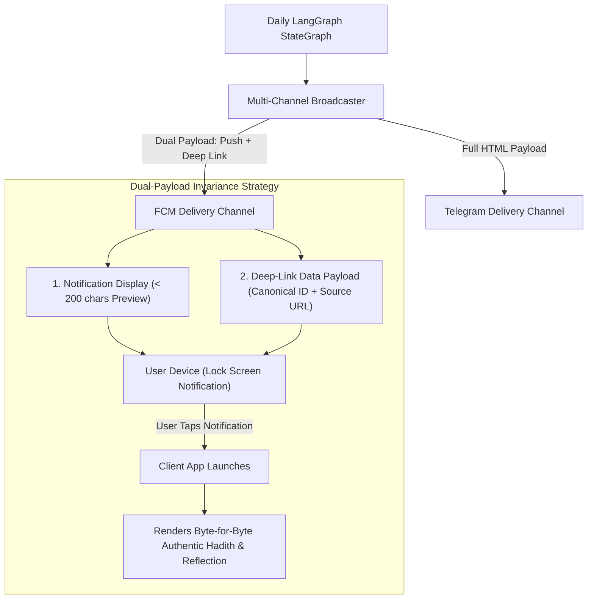
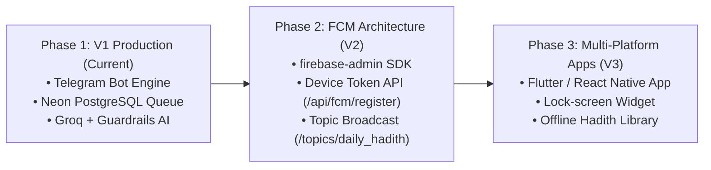

# Technical Design Document: Future Firebase Cloud Messaging (FCM) Integration

Architectural evaluation, payload schemas, and technical spike for multi-channel mobile and web push notifications in the **Daily Hadith AI Agent**.

---

## 1. Executive Summary & Purpose

In **V1**, the Daily Hadith AI Agent exclusively targets the **Telegram Bot API**. Telegram provides an exceptional conversational interface with zero client development cost, rich HTML rendering, and instant subscriber onboarding (`/start`).

However, requiring a Telegram account is a barrier for users who want daily notifications directly on their mobile device (iOS / Android) or web browser without installing a messaging app. 

This document establishes the **V2 architectural blueprint and technical spike** for integrating **Firebase Cloud Messaging (FCM)** as a second first-class notification channel, while preserving our core principles:
1. **Sacred Text Invariance:** Sacred Hadith text is never truncated, paraphrased, or corrupted by mobile push limits.
2. **Fail-Closed Gatekeeping:** Deterministic verification gates precede any push dispatch.
3. **Daily Delivery Idempotency:** The daily 10:00 AM IST schedule and per-device delivery tracking remain guaranteed.

---

## 2. Architectural Comparison: Telegram vs. FCM

| Dimension | Telegram Bot API (V1) | Firebase Cloud Messaging (V2 Spike) |
|---|---|---|
| **Client Requirement** | Telegram app installed + user account | Native Mobile App (Flutter/React Native) or Web PWA |
| **Subscriber Identifier** | Telegram Chat ID (`int`, e.g. `746451674`) | FCM Registration Token (`string`, 152+ chars) or Topic |
| **Payload Limit** | **4,096 UTF-8 characters** | **4,096 bytes (4 KB)** total HTTP payload limit |
| **Transport Model** | Direct HTTPS REST to Telegram Bot API | Google FCM Server → Apple APNs (iOS) / Google Play Services (Android) |
| **Message Formatting** | Rich HTML entities (`<b>`, `<i>`, `<a>`, `<pre>`) | Plain text notification title/body + rich JSON data payload |
| **Broadcast Model** | Sequential rate-limited fan-out (30 msg/sec) | Massive parallel multicast / **FCM Topics** (`/topics/daily_hadith_ist`) |
| **Cost** | 100% Free | 100% Free (unlimited FCM push volume via Google Firebase) |

---

## 3. Sacred Text & Theological Invariants under FCM Constraints

### The 4 KB Payload Boundary Challenge
FCM imposes a strict **4,096-byte limit** on data payloads. While most Hadiths easily fit within 1–2 KB, several extensive narrations in Sahih al-Bukhari and Sahih Muslim exceed 3,500 bytes of English text alone. Adding Arabic text, attribution metadata, and educational reflections could exceed the 4 KB boundary.

### The Architectural Solution: Dual-Payload Architecture
To eliminate truncation risk and guarantee zero text alteration, V2 enforces a **Notification + In-App Deep-Link Strategy**:



1. **Lock Screen Push Notification:** Displays canonical header, attribution, authenticity grade, and first 120 characters of the Hadith text as a teaser.
2. **Structured Data Payload:** Embeds `candidate_id`, `hadith_number`, `collection`, `source_url`, and cache keys.
3. **Client App Consumption:** When the user taps the notification, the mobile application displays the full, byte-for-byte unaltered English and Arabic text retrieved directly from the verified database.

---

## 4. Multi-Channel Strategy Pattern (Architecture)

To decouple workflow execution from specific delivery transports, V2 abstracts all notification channels behind a typed **Strategy Pattern**:

```python
from typing import Protocol, Any
from dataclasses import dataclass


@dataclass(frozen=True)
class NotificationPayload:
    title: str
    body: str
    collection: str
    hadith_number: str
    grade: str
    source_url: str
    ai_reflection: str | None
    raw_data: dict[str, Any]


class DeliveryChannel(Protocol):
    """Abstract interface implemented by all outbound delivery channels."""

    async def deliver(self, payload: NotificationPayload, target: str) -> dict[str, Any]:
        """Deliver payload to target (chat_id, device_token, or topic)."""
        ...

    async def broadcast(self, payload: NotificationPayload) -> dict[str, Any]:
        """Broadcast payload to all active subscribers on this channel."""
        ...
```

---

## 5. Database Schema Evolution Plan

To support multi-channel subscribers without breaking the existing `telegram_subscribers` table, V2 introduces a clean database schema migration:

### 5.1 New Table: `fcm_device_tokens`
```sql
CREATE TABLE fcm_device_tokens (
    id SERIAL PRIMARY KEY,
    device_token VARCHAR(255) UNIQUE NOT NULL,
    platform VARCHAR(32) NOT NULL, -- 'android' | 'ios' | 'web'
    app_version VARCHAR(32),
    is_active BOOLEAN NOT NULL DEFAULT TRUE,
    created_at TIMESTAMP WITH TIME ZONE DEFAULT NOW(),
    last_active_at TIMESTAMP WITH TIME ZONE DEFAULT NOW()
);

CREATE INDEX ix_fcm_device_tokens_platform ON fcm_device_tokens(platform);
CREATE INDEX ix_fcm_device_tokens_is_active ON fcm_device_tokens(is_active);
```

### 5.2 New Table: `fcm_delivery_logs`
```sql
CREATE TABLE fcm_delivery_logs (
    id SERIAL PRIMARY KEY,
    scheduled_date DATE NOT NULL,
    candidate_id INTEGER REFERENCES hadith_candidates(id),
    device_token_id INTEGER REFERENCES fcm_device_tokens(id),
    fcm_message_id VARCHAR(128),
    status VARCHAR(32) NOT NULL, -- 'SUCCESS' | 'FAILED' | 'UNREGISTERED'
    error_message TEXT,
    created_at TIMESTAMP WITH TIME ZONE DEFAULT NOW(),
    CONSTRAINT uq_fcm_delivery_date_device UNIQUE (scheduled_date, device_token_id)
);
```

---

## 6. FCM Payload Specification (JSON Schema)

### 6.1 Individual Device / Multicast Payload
```json
{
  "message": {
    "token": "dK1y8f...fcm_registration_token...",
    "notification": {
      "title": "Hadith of the Day — Sahih al-Bukhari (#1)",
      "body": "Actions are judged by intentions. Every person will have what they intended..."
    },
    "data": {
      "candidate_id": "66521",
      "collection": "Sahih al-Bukhari",
      "hadith_number": "1",
      "grade": "Authentic",
      "source_url": "https://hadeethenc.com/en/browse/hadith/66521",
      "scheduled_date": "2026-11-08",
      "has_reflection": "true",
      "click_action": "FLUTTER_NOTIFICATION_CLICK"
    },
    "android": {
      "priority": "high",
      "notification": {
        "channel_id": "daily_hadith_channel",
        "icon": "ic_hadith_notification",
        "color": "#064e3b"
      }
    },
    "apns": {
      "payload": {
        "aps": {
          "alert": {
            "title": "Hadith of the Day — Sahih al-Bukhari (#1)",
            "body": "Actions are judged by intentions..."
          },
          "badge": 1,
          "sound": "default"
        }
      }
    }
  }
}
```

### 6.2 Topic-Based Global Broadcast Payload (Zero Server Fan-Out)
Instead of sending 100,000 individual HTTP requests, the backend publishes **a single request** to the global topic:
```json
{
  "message": {
    "topic": "daily_hadith_ist",
    "notification": {
      "title": "Hadith of the Day — Sahih Muslim (#1955)",
      "body": "Indeed, Allah has enjoined Ihsan (kindness/excellence) in all things..."
    },
    "data": {
      "candidate_id": "66521",
      "source_url": "https://hadeethenc.com/en/browse/hadith/66521"
    }
  }
}
```
* **Performance:** Google Firebase distributes the message to millions of devices across Android and iOS within 2 seconds with **zero server CPU overhead**.

---

## 7. Phased Implementation Roadmap (Post-V1)



### Next Steps for Implementation:
1. **Firebase Project Creation:** Create Firebase project `daily-hadith-ai-agent` on Google Cloud Console.
2. **Service Account Credential:** Store `FIREBASE_CREDENTIALS_JSON` securely in environment secrets.
3. **Device Registration Endpoint:** Mount `POST /api/fcm/devices` to register and validate mobile device tokens.
4. **Integration with LangGraph:** Add `deliver_fcm_topic` node to the daily broadcast StateGraph.
