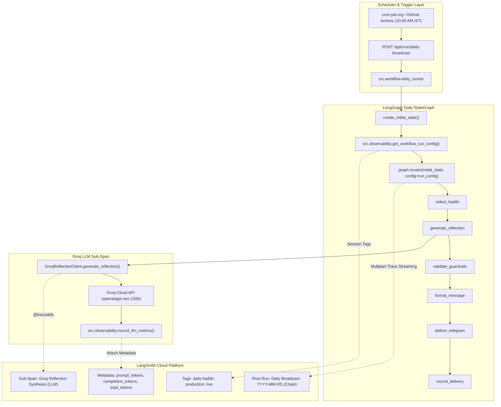

# Observability & LLMOps Architecture (LangSmith)

Comprehensive technical documentation for production observability, telemetry, token accounting, and distributed tracing in the **Daily Hadith AI Agent**.

---

## 1. Executive Summary & Objectives

In production AI applications, especially those operating on immutable canonical texts alongside probabilistic Large Language Models (LLMs), runtime observability is critical. The Daily Hadith AI Agent integrates **LangSmith** cloud observability to achieve:

1. **Deterministic Pipeline Auditing:** Tracing every discrete state transition within the LangGraph StateGraph (`select_hadith` → `generate_reflection` → `validate_guardrails` → `format_message` → `deliver_telegram` → `record_delivery`).
2. **Inference & Token Accounting:** Capturing exact input (prompt), output (completion), and aggregate token consumption per Groq LLM inference invocation (`openai/gpt-oss-120b`).
3. **Safety & Guardrail Monitoring:** Explicitly logging guardrail evaluations, theological boundary enforcement verdicts, and rejection fallbacks.
4. **Zero-Overhead Decoupling:** Isolating all telemetry constructs within [`src/observability/`](../src/observability/) so that domain business logic is decoupled from external observability SDKs.
5. **Air-Gapped & Offline Safety:** Ensuring that CI test suites, offline development, and network disruptions safely degrade without impeding the delivery of sacred Hadith content.

---

## 2. Distributed Tracing Architecture



---

## 3. Telemetry Schema & Captured Spans

### 3.1 Root Workflow Span (`Daily Broadcast: {YYYY-MM-DD}`)
* **Run Type:** `chain`
* **Name:** `Daily Broadcast: YYYY-MM-DD` (e.g. `Daily Broadcast: 2026-11-12`)
* **Tags:**
  * `daily-hadith`
  * `development` | `staging` | `production`
  * `live` | `dry_run`
* **Execution Metadata:**
  * `scheduled_date`: Target broadcast date (e.g., `2026-11-12`).
  * `is_dry_run`: Boolean indicating live Telegram dispatch vs. local simulation.
  * `app_env`: Runtime deployment environment (`production`).
  * `timezone`: Canonical timezone (`Asia/Kolkata`).
  * `groq_model`: Configured language model (`openai/gpt-oss-120b`).

### 3.2 StateGraph Node Spans
Every node function executed by LangGraph is automatically instrumented as a child span:
1. **`select_hadith`:** Candidate queue retrieval, priority ranking, and idempotency lock validation.
2. **`generate_reflection`:** Prompt assembly and invocation of the LLM synthesis pipeline.
3. **`validate_guardrails`:** Content inspection, Arabic text leakage detection, citation integrity check, and safety boundary evaluation.
4. **`format_message`:** HTML entity escaping, byte-length calculation (<4,096 chars), and payload assembly.
5. **`deliver_telegram`:** Multi-subscriber fan-out broadcasting, 30 msg/sec rate-limiting, and error tracking.
6. **`record_delivery`:** Persistence of delivery status (`SUCCESS`, `FAILED`) into `daily_delivery_logs`.

### 3.3 LLM Reflection Span (`Groq Reflection Synthesis`)
* **Run Type:** `llm`
* **Name:** `Groq Reflection Synthesis`
* **Tags:** `["llm", "groq", "reflection"]`
* **Injected Metrics & Metadata:**
  * `ls_provider`: `"groq"`
  * `ls_model_name`: Model identifier (e.g., `"openai/gpt-oss-120b"`).
  * `prompt_tokens`: Token length of the structured system prompt and Hadith text.
  * `completion_tokens`: Token length of the generated 3-bullet practical reflection.
  * `total_tokens`: Aggregate token count for cost analysis and quota monitoring.

---

## 4. Package Architecture (`src/observability/`)

The observability subsystem is organized into three single-responsibility files:

```text
src/observability/
├── __init__.py      # Clean public exports
├── tracer.py        # Metadata formatting, run config generation, metric injection
└── cli.py           # Developer & recruiter verification CLI
```

### 4.1 [`src/observability/tracer.py`](../src/observability/tracer.py)
* **`is_tracing_enabled() -> bool`:** Evaluates both `LANGCHAIN_TRACING_V2=true` and the presence of `LANGCHAIN_API_KEY`.
* **`get_workflow_run_config(scheduled_date, is_dry_run) -> dict[str, Any]`:** Constructs standardized metadata and tags consumed by `graph.invoke(..., config=run_config)`.
* **`record_llm_metrics(response, model_name, provider)`:** Interrogates raw completion usage attributes and records `prompt_tokens`, `completion_tokens`, and `total_tokens` directly to the active `RunTree`.
* **Fail-Safe Design:** If tracing is disabled or network fails, all tracer methods silently return without raising exceptions or interrupting Hadith delivery.

### 4.2 [`src/observability/cli.py`](../src/observability/cli.py)
A standalone CLI entrypoint for auditing, developer onboarding, and recruiter verification:
```bash
# Display configuration status and sample LangGraph metadata
python -m src.observability.cli

# Dispatch an end-to-end synthetic reflection trace to LangSmith
python -m src.observability.cli --verify
```

---

## 5. Test Isolation & Air-Gapped Verification

To preserve test execution speed and prevent test artifacts from polluting production dashboards:
1. **Pytest Global Fixture ([`tests/conftest.py`](../tests/conftest.py)):**
   - Automatically sets `LANGCHAIN_TRACING_V2="false"` for all test sessions.
   - Prevents background worker threads from attempting outbound network requests to `api.smith.langchain.com`.
2. **Dedicated Unit Suite ([`tests/test_observability.py`](../tests/test_observability.py)):**
   - Verifies `is_tracing_enabled()` logic under varying environment flag combinations.
   - Tests `get_workflow_run_config()` tag and metadata generation.
   - Mocks `RunTree` to verify that `record_llm_metrics()` accurately extracts token usage without live cloud access.
   - Verifies `cli.py` exit codes and formatted output.

---

## 6. Production Deployment Configuration (Render)

Because secret credentials are never committed to version control, configure these environment variables in your **Render Dashboard**:

| Environment Variable | Production Value | Description |
|---|---|---|
| `LANGCHAIN_TRACING_V2` | `true` | Activates LangSmith background trace streaming |
| `LANGCHAIN_API_KEY` | `lsv2_pt_...` | LangSmith Workspace API Token |
| `LANGCHAIN_PROJECT` | `daily-hadith-ai-agent` | Target project name for grouping traces |
| `LANGCHAIN_ENDPOINT` | `https://api.smith.langchain.com` | Official LangSmith cloud API ingestion endpoint |

---

## 7. Operational Verification Checklist

1. **Verify Local Diagnostics:**
   ```bash
   .venv/bin/python -m src.observability.cli
   ```
2. **Execute Headless Dry Run:**
   ```bash
   .venv/bin/python -m src.workflow.daily_runner --dry-run
   ```
3. **Inspect Cloud Dashboard:**
   - Navigate to [https://smith.langchain.com/](https://smith.langchain.com/).
   - Select project **`daily-hadith-ai-agent`**.
   - Confirm the presence of root trace: `Daily Broadcast: YYYY-MM-DD`.
   - Verify token metrics on the `Groq Reflection Synthesis` child span.
