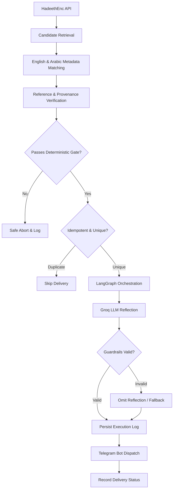

# Project Context & Developer Handover

> **Durable Source of Truth for Development Continuity**  
> *Last Updated:* Milestone 01 Verified (Commit 67ab4ea)

---

## 1. What We Are Building
An AI-assisted, production-grade notification application named **Daily Hadith AI Agent**. It delivers exactly **one verified English Hadith notification to a Telegram account every day at 10:00 AM Asia/Kolkata**.

Each notification contains:
1. Exact, unchanged English Hadith text retrieved from an approved source.
2. Verified collection name and citation reference.
3. Canonical source-page URL.
4. Source attribution and translation version metadata.
5. An optional, clearly segregated and labeled AI reflection (if permitted by source terms).

---

## 2. Why We Are Building It
This is a portfolio-grade demonstration of dependable, fail-closed AI engineering:
- Orchestrating a deterministic validation pipeline alongside an LLM using **LangGraph**.
- Strict separation between canonical immutable source data and generative AI commentary.
- Production-grade backend architecture, automated testing, idempotent scheduling, containerization, and cloud deployment.
- Demonstrating that in high-stakes domains (theological, legal, medical), AI must be bounded by deterministic verification gates.

---

## 3. High-Level Architecture & Flow

---

## 4. Selected Technology Stack
- **Language:** Python 3.14.6 (macOS arm64 environment; package compatibility with dependencies to be audited in Milestone 03).
- **AI Orchestration:** LangGraph (typed state graph with conditional edges).
- **LLM Provider:** Groq (`openai/gpt-oss-120b` or verified equivalent available model).
- **Validation:** Pydantic v2, deterministic Python verification, Guardrails AI.
- **Backend Framework:** FastAPI.
- **Database:** SQLite (local development), Neon PostgreSQL (production deployment).
- **Notification Provider:** Telegram Bot API.
- **Search & Secondary Research (MCP):** Tavily via MCP (strictly for auxiliary verification, never as primary Hadith source).
- **Quality & DevOps:** pytest, Ruff, Docker, Git/GitHub.
- **Target Deployment:** Render / containerized worker + Neon PostgreSQL.

---

## 5. Approved Source Strategy
- **Primary Source:** HadeethEnc (official public API: `https://hadeethenc.com/en/home`).
- **Target Collections:** Sahih al-Bukhari and Sahih Muslim.
- **Coverage Policy:** HadeethEnc is recognized as a curated selection, not an exhaustive repository.
- **English Translation:** Mandatory. LLM is strictly prohibited from generating or modifying Hadith text.
- **Verification Rule:** Every English record must be paired with its Arabic counterpart to verify reference integrity and canonical provenance.
- **Fail-Closed Principle:** Any record with missing metadata, mismatched references, or ambiguous provenance is rejected immediately.
- **No Scraping:** Only official API endpoints or permitted official exports are used.

---

## 6. Current Milestone and Task
- **Active Milestone:** Milestone 02 — Source Validation Specification
- **Active Task:** Task 2.1 — Inspect and Document Official HadeethEnc API Endpoints

---

## 7. Completed and Verified Work
- [x] **Milestone 01 Verified:** Project foundation established and committed (`67ab4ea`).
  - [x] Workspace inspected (macOS arm64, zsh, Python 3.14.6, Git 2.54.0).
  - [x] Git repository initialized on `main`.
  - [x] `.gitignore` configured and active.
  - [x] Directory scaffolding (`docs/`, `src/`, `tests/`) tracked with `.gitkeep`.
  - [x] 20-milestone roadmap (`docs/PROJECT_ROADMAP.md`) published.
  - [x] Developer context handover (`docs/PROJECT_CONTEXT.md`) established.
  - [x] Public documentation (`README.md`) published.

---

## 8. Work in Progress
- Milestone 02: Source Validation Specification.
  - Task 2.1: Audit official HadeethEnc API documentation and current GET endpoints.
  - Task 2.2: Specify English/Arabic ID and record cross-matching contract.
  - Task 2.3: Define reference verification rules for Sahih al-Bukhari and Sahih Muslim.
  - Task 2.4: Specify record rejection criteria and create `docs/API_CONTRACTS.md`.

---

## 9. Open Questions and Technical Blockers
1. **Python 3.14 vs. 3.13:** The local development machine runs Python 3.14.6. When installing LangGraph, Guardrails AI, and FastAPI in Milestone 03, we will audit whether all dependencies have pre-built wheels for 3.14 or if a 3.13 virtual environment is required.
2. **HadeethEnc API Contract:** Official GET endpoint fields, rate limits, and Arabic/English ID mapping must be audited against live API specs in Milestone 02.

---

## 10. Key Architecture Decisions (ADR Summary)
- **ADR-001 (Developer Control):** The developer maintains absolute manual control over all code, configuration, and Git operations. The AI assistant acts strictly as mentor/reviewer and never edits workspace files directly.
- **ADR-002 (Fail-Closed Content Safety):** The system must fail closed. Under no circumstances may an LLM hallucinate, translate, or paraphrase sacred text. If validation fails, zero message is sent.
- **ADR-003 (Deterministic Gatekeeping):** Theological validation is strictly deterministic (Pydantic + exact metadata matching). Generative AI is restricted to supplementary reflections only.
- **ADR-004 (Telegram for V1 Delivery):** Telegram Bot API is the single confirmed notification channel for V1, utilizing secure bot tokens and explicit chat IDs.

---

## 11. Important Constraints
- **Zero Hardcoded Secrets:** No API keys, bot tokens, or database URLs in source code or commits.
- **Attribution Integrity:** Every delivered message must retain publisher attribution, translation version, and canonical link.
- **Idempotent Delivery:** The scheduler and persistence layer must ensure at most one delivery per calendar day.

---

## 12. Exact Next Action
Begin Milestone 02: Audit HadeethEnc API contracts and create `docs/API_CONTRACTS.md`.

---

## 13. Latest Verification Evidence
- Milestone 01 committed cleanly under Git commit `67ab4ea`.
- Repository tree verified with `git status` clean.

---

## 14. Known Limitations
- Current scope is restricted to curated Hadith available on HadeethEnc; complete exhaustive collections are out of scope for V1.
- Delivery is single-channel (Telegram) for V1; push notifications (FCM) deferred to future iterations. 
