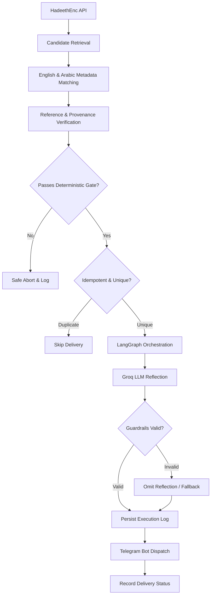

# Project Context & Developer Handover

> **Durable Source of Truth for Development Continuity**  
> *Last Updated:* Milestone 10 Verified

---

## 1. What We Are Building
An AI-assisted, production-grade notification application named **Daily Hadith AI Agent**. It delivers exactly **one verified English Hadith notification to a Telegram account every day at 10:00 AM Asia/Kolkata**.

Each notification contains:
1. Exact, unchanged English Hadith text retrieved from an approved source.
2. Verified collection name and citation reference.
3. Canonical source-page URL.
4. Source attribution and translation version metadata.
5. An optional, clearly segregated and labeled AI reflection (if permitted by source terms).

---

## 2. Why We Are Building It
This is a portfolio-grade demonstration of dependable, fail-closed AI engineering:
- Orchestrating a deterministic validation pipeline alongside an LLM using **LangGraph**.
- Strict separation between canonical immutable source data and generative AI commentary.
- Production-grade backend architecture, automated testing, idempotent scheduling, containerization, and cloud deployment.
- Demonstrating that in high-stakes domains (theological, legal, medical), AI must be bounded by deterministic verification gates.

---

## 3. High-Level Architecture & Flow

---

## 4. Selected Technology Stack
- **Language:** Python 3.14.6 (macOS arm64 environment; package compatibility with dependencies to be audited in Milestone 03).
- **AI Orchestration:** LangGraph (typed state graph with conditional edges).
- **LLM Provider:** Groq (`openai/gpt-oss-120b` or verified equivalent available model).
- **Validation:** Pydantic v2, deterministic Python verification, Guardrails AI.
- **Backend Framework:** FastAPI.
- **Database:** SQLite (local development), Neon PostgreSQL (production deployment).
- **Notification Provider:** Telegram Bot API.
- **Search & Secondary Research (MCP):** Tavily via MCP (strictly for auxiliary verification, never as primary Hadith source).
- **Quality & DevOps:** pytest, Ruff, Docker, Git/GitHub.
- **Target Deployment:** Render / containerized worker + Neon PostgreSQL.

---

## 5. Approved Source Strategy
- **Primary Source:** HadeethEnc (official public API: `https://hadeethenc.com/en/home`).
- **Target Collections:** Sahih al-Bukhari and Sahih Muslim.
- **Coverage Policy:** HadeethEnc is recognized as a curated selection, not an exhaustive repository.
- **English Translation:** Mandatory. LLM is strictly prohibited from generating or modifying Hadith text.
- **Verification Rule:** Every English record must be paired with its Arabic counterpart to verify reference integrity and canonical provenance.
- **Fail-Closed Principle:** Any record with missing metadata, mismatched references, or ambiguous provenance is rejected immediately.
- **No Scraping:** Only official API endpoints or permitted official exports are used.

---

## 6. Current Milestone and Task
- **Active Milestone:** Milestone 09 — Groq Integration
- **Active Task:** Task 9.1 — Groq Client, System Prompts, and Reflection Segregation

---

## 7. Completed and Verified Work
- [x] **Milestone 01 Verified:** Project foundation, Git setup, directories, roadmap, context, and README committed (`67ab4ea`, `8162470`).
- [x] **Milestone 02 Verified:** Source Validation Specification (`58b7256`).
  - Live empirical audit of HadeethEnc endpoints.
  - Invariant defined: `en.hadeeth_ar == ar.hadeeth`.
  - Deterministic regex grammar specified for Bukhari and Muslim citations.
  - Rejection matrix and test cases formalized in `docs/API_CONTRACTS.md`.
- [x] **Milestone 03 Verified:** Configuration and Secrets (`e848cf0`).
  - Virtual environment `.venv` configured on Python 3.14.6 arm64.
  - `requirements.txt` and `pyproject.toml` established.
  - `.env.example` created with strict zero-secret placeholders.
  - `src/config.py` implemented with Pydantic v2 `BaseSettings` and safe secret masking.
  - `tests/test_config.py` automated unit test suite passing 6/6 tests.
- [x] **Milestone 10 Verified:** Guardrails AI & Reflection Safety Verification.
  - Implemented deterministic boundary rules in `src/guardrails/rules.py` (prohibiting fatwas, unauthorized citations, verbatim text leakage, and word count violations).
  - Implemented pure validation engine in `src/guardrails/validator.py` (`ReflectionValidator`, `validate_reflection`).
  - Integrated `validate_guardrails` node into LangGraph StateGraph in `src/workflow/graph.py` and `src/workflow/nodes.py`.
  - Added 10 automated unit tests in `tests/test_guardrails.py` and 2 workflow integration tests in `tests/test_workflow.py`.
  - Full automated test suite achieves 51/51 passing in 1.71s (100% pass rate).
- [x] **Milestone 09 Verified:** Groq Integration & Reflection Fallback.
  - Installed `groq>=0.9.0` (version 1.7.0 verified on Python 3.14.6 arm64).
  - Created `src/llm/prompts.py` enforcing strict theological negative constraints (no text modification, no fatwas, practical reflections capped under 120 words).
  - Created `src/llm/client.py` (`GroqReflectionClient`) with resilient failover to `OMITTED` (when `GROQ_API_KEY` is not provided) or `FAILED` (upon API error) without halting Hadith delivery.
  - Exported facade in `src/llm/__init__.py` and documented package in `src/llm/README.md`.
  - Integrated `generate_reflection` node into LangGraph StateGraph in `src/workflow/graph.py` and `src/workflow/nodes.py`.
  - Added 5 unit tests in `tests/test_llm.py`. Full test suite achieves 39/39 passing in 1.68s.
- [x] **Milestone 08 Verified:** LangGraph StateGraph Workflow & Live Idempotency.
  - Installed `langgraph>=0.2.0` (version 1.2.20 verified on Python 3.14.6).
  - Implemented typed state schema in `src/workflow/state.py` (`DailyWorkflowState`).
  - Implemented pure node functions in `src/workflow/nodes.py` (idempotency check, queue selection, defense-in-depth safety validation, Telegram formatting, and delivery logging).
  - Built compiled StateGraph with conditional edge routers in `src/workflow/graph.py` and exported facade in `src/workflow/__init__.py`.
  - Built 4 automated unit tests in `tests/test_workflow.py` validating all 4 branching pathways (happy path, idempotency skip, queue empty abort, safety abort).
  - Full test suite achieves 34/34 passing in 0.27s.
  - Live empirical execution on Neon PostgreSQL completed delivery for Candidate 1 (Agreed Upon #6953) and demonstrated instant idempotency skip on subsequent execution.
- [x] **Milestone 07 Verified:** Deterministic Validation Engine & Candidate Ingestion.
  - Implemented `CandidateIngestionService` and `ingest_candidate_pair` in `src/ingestion/service.py`.
  - Integrated dual HadeethEnc retrieval, deterministic verification, deduplication, and database persistence.
  - Built 4 automated unit and integration tests in `tests/test_ingestion.py` covering verified persistence, rejection auditability, deduplication, and batch metrics.
  - Full test suite achieves 30/30 passing in 0.22s.
  - Empirical live ingestion executed against Neon PostgreSQL inserting 9 verified and 1 rejected candidates from Category 5.
  - Proved candidate queue readiness via `get_next_verified_candidate()` (Candidate ID 66511: Agreed Upon #6953).
- [x] **Milestone 06 Verified:** Source Catalogue Audit & Acceptance Policy.
  - Audited HadeethEnc root taxonomy (7 root categories, 452 subcategories, 2,776+ Hadiths).
  - Sampled Tier-1 categories (Virtues & Manners, Noble Qur’an) demonstrating 60–75% empirical pass rates.
  - Discovered and addressed bibliographic-only citations; hardened verifier to reject records lacking explicit Hadith numbers fail-closed.
  - Established sustainable candidate pool sizing (~913 verified Hadiths, supporting 2.5 years of non-repeating delivery).
  - Formalized audit findings and acceptance rules in `docs/SOURCE_CATALOGUE_AUDIT.md`.
- [x] **Milestone 05 Verified:** HadeethEnc Integration & Deterministic Verifier.
  - Implemented typed Pydantic v2 schemas (`src/hadeethenc/schemas.py`) for list responses, English/Arabic detail payloads, and paired candidate structures.
  - Created robust `HadeethEncClient` (`src/hadeethenc/client.py`) with timeout controls, retries, and typed domain exceptions (`HadeethEncNotFoundError`, `HadeethEncNetworkError`, `HadeethEncResponseError`).
  - Implemented deterministic cross-verifier (`src/hadeethenc/verifier.py`) enforcing cross-payload Arabic text identity (`en.hadeeth_ar == ar.hadeeth`), collection attribution validation, and regex canonical citation extraction.
  - Added 14 comprehensive unit and contract tests in `tests/test_hadeethenc.py` using `httpx.MockTransport`. Full test suite achieves 25/25 passing in 0.27s.
  - Verified live against HadeethEnc production API with real Hadith records (`5907`, `5913`).
- [x] **Milestone 04 Verified:** Database Foundation & Neon PostgreSQL.
  - Connected directly to Neon PostgreSQL (PostgreSQL 18.6) over SSL pooler using modern `psycopg` driver.
  - Refactored persistence into modular `src/database/` package (`session.py`, `models.py`, `repository.py`).
  - Generated and stamped Alembic initial migration (`f02e818f721d_initial_schema.py`).
  - Database unique constraint on `DailyDeliveryLog.scheduled_date` enforces daily idempotency.
  - Repository layer implemented for candidate deduplication and delivery history.
  - 11/11 automated unit tests passing across `tests/test_database.py` and `tests/test_config.py`.

---

## 8. Work in Progress
- Milestone 11: Final Content Validation.
  - Task 11.1: End-to-end audit of assembled notification payloads against source integrity guidelines.
  - Task 11.2: Verify zero hallucination or unverified reference leakage in final payloads.
  - Task 11.3: Validate Markdown/HTML escaping contracts before Telegram delivery integration.

---

## 9. Open Questions and Technical Blockers
1. **Python 3.14 vs. 3.13:** The local development machine runs Python 3.14.6. When installing LangGraph, Guardrails AI, and FastAPI in Milestone 03, we will audit whether all dependencies have pre-built wheels for 3.14 or if a 3.13 virtual environment is required.
2. **HadeethEnc API Contract:** Official GET endpoint fields, rate limits, and Arabic/English ID mapping must be audited against live API specs in Milestone 02.

---

## 10. Key Architecture Decisions (ADR Summary)
- **ADR-001 (Developer Control):** The developer maintains absolute manual control over all code, configuration, and Git operations. The AI assistant acts strictly as mentor/reviewer and never edits workspace files directly.
- **ADR-002 (Fail-Closed Content Safety):** The system must fail closed. Under no circumstances may an LLM hallucinate, translate, or paraphrase sacred text. If validation fails, zero message is sent.
- **ADR-003 (Deterministic Gatekeeping):** Theological validation is strictly deterministic (Pydantic + exact metadata matching). Generative AI is restricted to supplementary reflections only.
- **ADR-004 (Telegram for V1 Delivery):** Telegram Bot API is the single confirmed notification channel for V1, utilizing secure bot tokens and explicit chat IDs.

---

## 11. Important Constraints
- **Zero Hardcoded Secrets:** No API keys, bot tokens, or database URLs in source code or commits.
- **Attribution Integrity:** Every delivered message must retain publisher attribution, translation version, and canonical link.
- **Idempotent Delivery:** The scheduler and persistence layer must ensure at most one delivery per calendar day.

---

## 12. Exact Next Action
Begin Milestone 11: Final Content Validation and end-to-end payload assembly contracts.

---

## 13. Latest Verification Evidence
- **51/51 Automated Tests Passing:** 100% pass rate in 1.71s across all modules (`tests/test_config.py`, `tests/test_database.py`, `tests/test_guardrails.py`, `tests/test_hadeethenc.py`, `tests/test_ingestion.py`, `tests/test_llm.py`, `tests/test_workflow.py`).
- **Guardrails AI Validation Gate:** Actively wired into LangGraph StateGraph, proven to strip invalid commentary fail-safe while delivering authentic Hadith texts without disruption.
- **Full End-to-End Live Execution Verified:** Executed `scripts/test_e2e_workflow.py` with live Groq Cloud API (`openai/gpt-oss-120b`) and live Neon PostgreSQL database.
  - Step 1: Live Groq reflection generated with theological negative constraints strictly observed.
  - Step 2: Delivered Candidate 4 (Agreed Upon #13) from Neon DB with verified source attribution and segregated `💡 Reflection & Context`.
  - Step 3: Verified daily idempotency guard (`SKIPPED_IDEMPOTENT`) blocking duplicate delivery.

---

## 14. Known Limitations
- Current scope is restricted to curated Hadith available on HadeethEnc; complete exhaustive collections are out of scope for V1.
- Delivery is single-channel (Telegram) for V1; push notifications (FCM) deferred to future iterations. 
