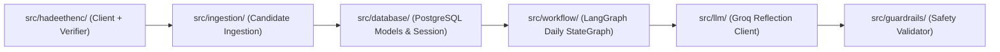

# Application Source Code (`src/`)

This directory contains the core source code for the **Daily Hadith AI Agent**.

The application is structured into decoupled, domain-driven packages where each module enforces strict boundaries between deterministic religious data, database persistence, and probabilistic AI orchestration.

---

## Package Directory Map

| Package | Responsibility | Documentation Guide |
|---|---|---|
| **[`src/config.py`](config.py)** | Centralized Pydantic v2 application settings, secret masking, and IANA timezone validation (`Asia/Kolkata`). | Covered in [Root README](../README.md) |
| **[`src/database/`](database/)** | Neon PostgreSQL persistence layer, SQLAlchemy 2.0 ORM models, session management, and idempotency queries. | **[`src/database/README.md`](database/README.md)** |
| **[`src/hadeethenc/`](hadeethenc/)** | Resilient HTTP client, Pydantic response models, and deterministic Arabic/English invariant verifier. | **[`src/hadeethenc/README.md`](hadeethenc/README.md)** |
| **[`src/ingestion/`](ingestion/)** | Candidate ingestion service, deduplication logic, and batch category scanner. | **[`src/ingestion/README.md`](ingestion/README.md)** |
| **[`src/workflow/`](workflow/)** | LangGraph StateGraph state machine orchestrating daily idempotency, candidate selection, safety gates, and delivery. | **[`src/workflow/README.md`](workflow/README.md)** |
| **[`src/llm/`](llm/)** | Groq LLM reflection client, negative prompt constraints, and resilient failover. | **[`src/llm/README.md`](llm/README.md)** |
| **[`src/guardrails/`](guardrails/)** | Deterministic content validation, theological boundaries, text leakage, and citation verification. | **[`src/guardrails/README.md`](guardrails/README.md)** |

---

## Architecture Flow

## Architectural Guidelines
1. **Separation of Concerns:** External API calls are isolated in `hadeethenc/`, storage operations are isolated in `database/`, and execution orchestration is managed by `workflow/`.
2. **Deterministic First:** No candidate record reaches the delivery queue unless it passes the invariant checks in `src/hadeethenc/verifier.py`.
3. **No Hardcoded Secrets:** All credentials (`DATABASE_URL`, `TELEGRAM_BOT_TOKEN`, `GROQ_API_KEY`) are accessed strictly through `src.config.get_settings()`.

