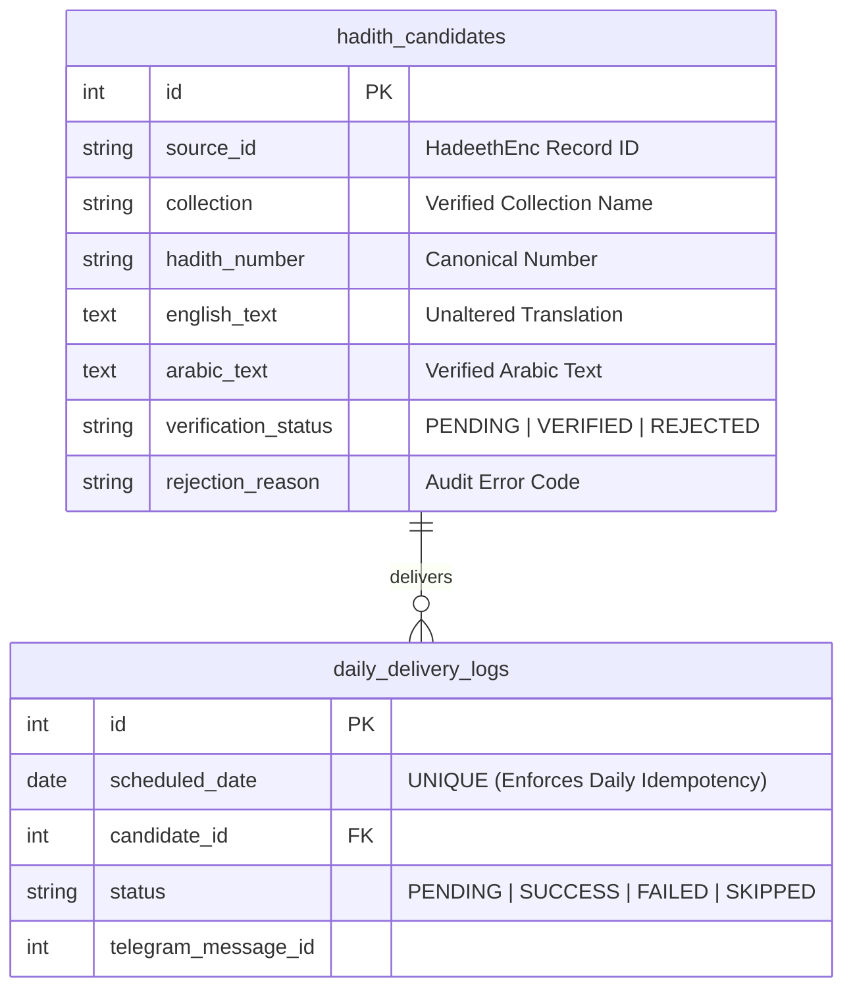

# Database Persistence Package (`src/database/`)

This package manages all persistence operations for the Daily Hadith AI Agent, including PostgreSQL connection pooling, SQLAlchemy 2.0 ORM models, repository query helpers, and Alembic database schema migrations.

---

## Module Overview

| File | Purpose | Key Exports |
|---|---|---|
| **[`session.py`](session.py)** | Engine management and transactional session contexts | `get_db_session()`, `engine`, `Base` |
| **[`models.py`](models.py)** | Declarative SQLAlchemy ORM database tables | `HadithCandidate`, `DailyDeliveryLog` |
| **[`repository.py`](repository.py)** | Encapsulated CRUD operations & idempotency queries | `save_candidate()`, `get_next_verified_candidate()`, `is_date_delivered()`, `record_delivery_log()` |
| **[`__init__.py`](__init__.py)** | Public package interface | Clean imports for external modules |

---

## Database Architecture & Invariants

### Key Engineering Features
- **Neon PostgreSQL over SSL:** Connects using modern `psycopg` (v3) driver with PgBouncer connection pooling (`-pooler` host) and `pool_pre_ping=True`.
- **Physical Idempotency Constraint:** `daily_delivery_logs.scheduled_date` carries a physical `UNIQUE` constraint preventing duplicate daily dispatches at the database engine level.
- **Fail-Closed Audit Trail:** Candidates failing verification are stored with `verification_status="REJECTED"` and a structured `rejection_reason` to prevent duplicate API fetches and maintain auditability.