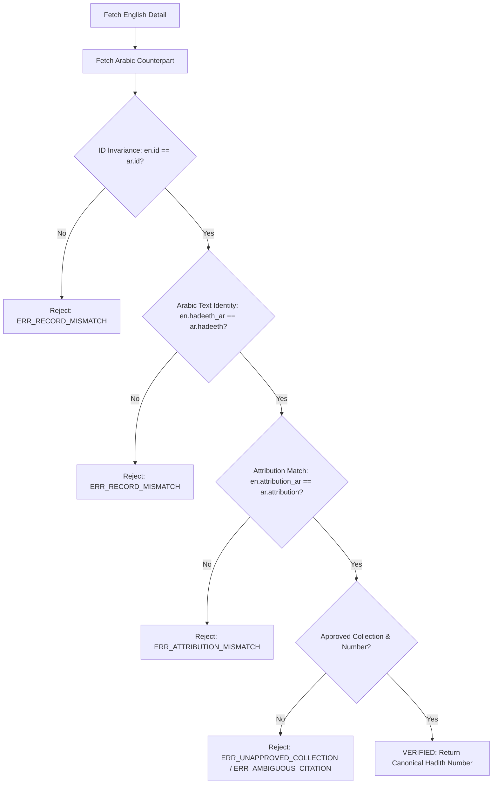

# HadeethEnc Integration Package (`src/hadeethenc/`)

This package provides a typed HTTP client and deterministic invariant verification engine for the official [HadeethEnc REST API](https://hadeethenc.com/api/v1/).

---

## Module Overview

| File | Purpose | Key Exports |
|---|---|---|
| **[`client.py`](client.py)** | Resilient HTTP client using `httpx` with timeout management and retries | `HadeethEncClient`, domain exceptions |
| **[`schemas.py`](schemas.py)** | Strict Pydantic v2 data models for API list and detail payloads | `HadeethEncListResponse`, `HadeethEncEnglishDetail`, `HadeethEncArabicDetail`, `HadeethEncCandidatePair` |
| **[`verifier.py`](verifier.py)** | Deterministic cross-payload validator and regex citation parser | `verify_candidate_pair()`, `VerificationResult` |
| **[`__init__.py`](__init__.py)** | Public package interface | Unified façade for external modules |

---

## Deterministic Verification Invariants

### Approved Collection Regex Grammar
- **Sahih al-Bukhari:** `صحيح البخاري(?:\s*\(\d+/\s*\d+\))?\s*\((\d+)\)`
- **Sahih Muslim:** `صحيح مسلم(?:\s*\(\d+/\s*\d+\))?\s*\((\d+)\)`
- **Agreed Upon:** Both collections matched or explicitly attributed with `متفق عليه`.