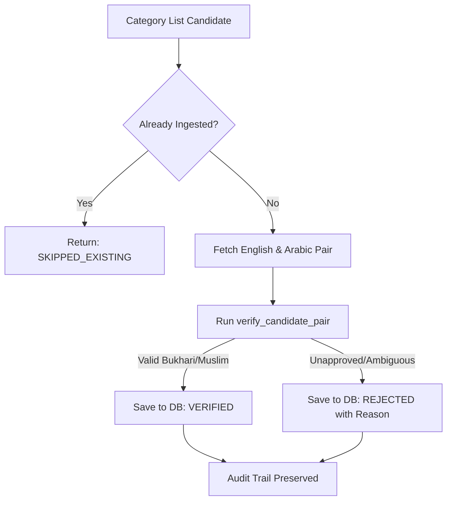

# Candidate Ingestion Package (`src/ingestion/`)

This package bridges external API retrieval with internal database persistence. It coordinates candidate discovery, deterministic verification, deduplication, and database storage.

---

## Module Overview

| File | Purpose | Key Exports |
|---|---|---|
| **[`service.py`](service.py)** | Candidate ingestion coordinator and batch category scanner | `CandidateIngestionService`, `ingest_candidate_pair()`, `IngestionResult`, `BatchIngestionSummary` |
| **[`__init__.py`](__init__.py)** | Public package interface | Unified facade exports |

---

## Workflow Flowchart

### Key Functions
- **`ingest_candidate_pair(session, pair, force_reverify=False)`**: Deterministically verifies a candidate pair and commits it to the database.
- **`CandidateIngestionService.ingest_category_batch(session, category_id, page, per_page)`**: Scans a full page of candidates from a specific category (e.g. Category 5: Virtues & Manners), persists new candidates, and computes summary metrics.