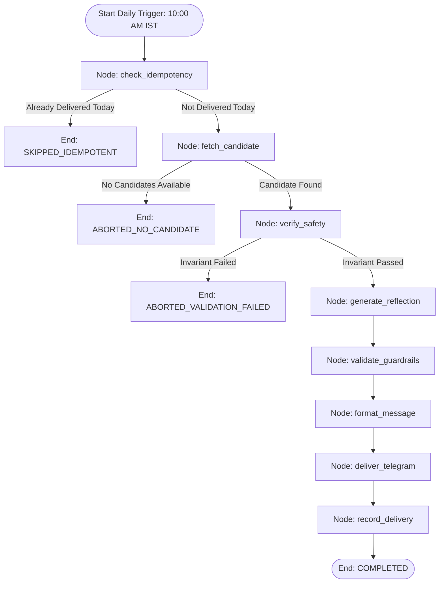

# LangGraph Workflow Orchestration Package (`src/workflow/`)

This package implements the end-to-end daily delivery pipeline as a typed, observable **LangGraph StateGraph** with deterministic routing and fail-closed safety abort edges.

---

## Module Overview

| File | Purpose | Key Exports |
|---|---|---|
| **[`state.py`](state.py)** | Typed state dictionary definition flowing through all nodes | `DailyWorkflowState`, `create_initial_state()`, `get_current_ist_date()` |
| **[`nodes.py`](nodes.py)** | Pure, testable node functions executing pipeline steps | `WorkflowNodes`, `APPROVED_COLLECTIONS` |
| **[`graph.py`](graph.py)** | StateGraph assembly, conditional edge routers, and compiler | `build_daily_workflow_graph()`, `run_daily_workflow()` |
| **[`daily_runner.py`](daily_runner.py)** | Headless CLI runner for Cloud Run Jobs, cron triggers, and manual runs | `run_daily_broadcast()`, `main()` |
| **[`scheduler.py`](scheduler.py)** | In-process background scheduler for 10:00 AM IST with 1-hour misfire recovery | `create_daily_scheduler()`, `start_daily_scheduler()`, `get_scheduler_status()` |
| **[`__init__.py`](__init__.py)** | Public package interface | Unified workflow exports |

---

## StateGraph Architecture & Routing



### CLI Execution
```bash
# Run for current date in Asia/Kolkata
python -m src.workflow.daily_runner

# Dry run mode (simulate delivery without calling Telegram)
python -m src.workflow.daily_runner --dry-run

# Run for a specific date
python -m src.workflow.daily_runner --date 2026-11-25
```

### Execution Example
```python
from src.workflow import run_daily_workflow

# Run daily execution for Asia/Kolkata date
final_state = run_daily_workflow(scheduled_date="2026-11-05")
print(final_state["status"])  # COMPLETED or SKIPPED_IDEMPOTENT
print(final_state["formatted_message"])
```